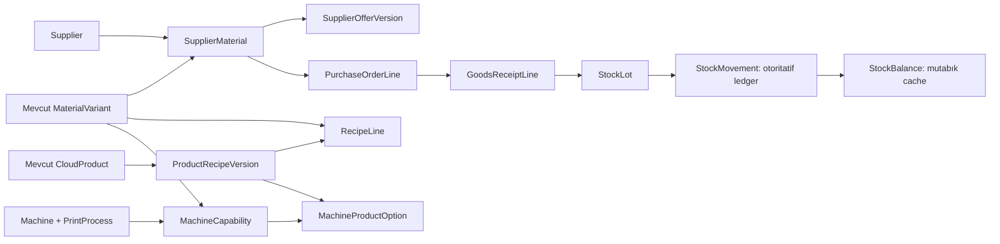

# PUSULA v0.4 — V4.1 veri modeli

19.10.2026 · temel `3bcbe9e` · **UYGULANMAMIŞ TASARIM**. Prisma taslağı, SQL planı ve test matrisi geliştirme girdisidir; migration, yeni tablo veya çalışan modül değildir. [Domain servisleri](V04_DOMAIN_SERVICES.md), [migration taslağı](drafts/V04_MIGRATION_PLAN.md), [Prisma taslağı](drafts/V04_SCHEMA.prisma), [denetim](../../research/PUSULA_V04_SPRINT_V41_AUDIT.md).

## Mevcut model ve tek otorite

Kodda 34 Prisma modeli / 34 CREATE TABLE vardır; `_prisma_migrations` ile public kapsamı **35** olur. FORCE RLS listesi **21** tablodur: Tenant, LegalEntity, Activity, Customer, Material, MaterialVariant, MaterialPriceHistory, Membership, PermissionScope, RoleAssignment, UserPermissionOverride, AuditEvent, TenantExchangeRate ve sekiz Cloud işletme tablosu. Auth tabloları ayrı auth rolü/grant sınırındadır; her mevcut tablo FORCE RLS demek değildir. Migration DO/FOREACH döngüleri de sayılmıştır. Bu kaynak kod denetimidir; yeni canlı katalog sorgusu yapılmadı.

`Material`/`MaterialVariant` satın alınan girdidir, `CloudProduct` satılabilir ürün/hizmettir. Yeni Material, CloudMaterial, ProductOrService, fiyat ana tablosu veya gerçek stok için localStorage oluşturulmaz. `Material.supplierReference` eski açıklama metnidir; Supplier ilişkisinin otoritesi olmaz. `MaterialVariant.inStock` manuel eski bayraktır; ledger açılan varyantta fiziksel bakiye veya stokta-var göstergesi olarak kullanılmaz. Geçişte mevcut bayrak korunur, yeni DTO ayrı `inventoryTracked/availableBase` alanları verir; kayıtlar otomatik açılış stoku sayılmaz.

Üç maliyet kaynağı ayrıdır: (1) kullanıcı kaynaklı Variant.usdCost + MaterialPriceHistory, (2) tedarikçinin bağımsız SupplierOfferVersion'ı, (3) gerçek kabulün satın alma maliyet snapshot'ı. Bunlar birbirlerine otomatik yazmaz. Eski CloudQuote/CloudSale/Line snapshot'ları yeni reçete veya tarifeyle yeniden hesaplanmaz. Mevcut gerçek izin adları `materials.costView/costEdit`tir; roadmap'teki `materials.cost.edit` semantik karşılığıdır, ikinci paralel izin yaratılmaz.

## Ortak alanlar ve ilişkisel sınır

Yeni 24 tablonun tamamı `id UUID`, `tenantId UUID`, **zorunlu legalEntityId UUID**, nullable activityId, createdById (AuthUser.id ile uyumlu text), createdAt timestamptz(3) ve `UNIQUE(tenantId,legalEntityId,id)` taşır. Şirket seviyesinde supplier paylaşımı bilinçli seçimdir: tenant genelinde nullable şirketli supplier tasarlamak yerine her şirket kendi kartını tutar. Ortak gerçek tedarikçiye ait kartlar şirketler arasında otomatik bağlanmaz.

Bütün entity ilişkileri `(tenantId,legalEntityId,foreignId)` composite FK, `ON DELETE RESTRICT/ON UPDATE RESTRICT` kullanır. Activity FK `(tenantId,legalEntityId,activityId)`; null yalnız şirket genelini anlatır. Çocuk activity/createdBy değerlerini kendi parent'ından miras alır; kendi payload'ından belirleyemez. SQL guard aynı şirket içinde de uyumsuz parent/child activity'yi engeller. Şirket genelindeki kartı faaliyetli belgede kullanmak için hem kartı hem belgeyi okuma yetkisi gerekir. Actor tarihsel metindir, gerçek Auth tablosuna yeni runtime SELECT verilmez; aktif membership sunucuda doğrulanır.

Prisma dosyası mevcut şemanın **ayrı kopyası + 24 ek model** ve relation backref'leridir. Canlı `prisma/schema.prisma` değişmez. SQL-only CHECK, ledger posting, immutability, daha güçlü bileşik variant/source tutarlılığı, activity ve RLS kuralları migration planının zorunlu parçalarıdır; yalnız `prisma validate` iş kurallarını kanıtlamaz.

## Tedarik ve satın alma — dokuz model

| Model | Alanlar/ilişkiler ve veri kuralı |
| --- | --- |
| Supplier | Kod, unvan, vergi/iletişim/adres, varsayılan para birimi, termin, active, optimistic version; şirket+kod unique. Silme yerine pasifleme. Para birimi varsayılandır, işlem snapshot'ını değiştirmez. |
| SupplierMaterial | Supplier ↔ mevcut MaterialVariant; supplierSku, purchaseUnit, minOrderQty, leadTimeDays, active, version. Supplier+variant unique; aynı varyant iki supplier'a bağlanabilir. SKU serbest metin, kimlik değildir. |
| SupplierOfferVersion | SupplierMaterial+revision unique; originalCurrency (USD/TRY/EUR), originalUnitPrice, purchaseUnit, minQty, validFrom/validUntil, normalizedUsdUnitPrice?, fxSnapshot?, conversionSnapshot. Append-only; fiyat kademesi ve dönüşüm o revizyonla sabit. Geçerlilik bitişi exclusive; revizyonla supersede, eski satır UPDATE yok. Çakışmada server açık revizyon seçer, rastgele son satır seçmez. |
| PurchaseOrder | Supplier, businessNo, revision/revisesOrderId, status, idempotencyKey/payloadHash, approvedAt/By, version. Sipariş miktarı fiziksel stok değildir. Draft→approved→closed/cancelled; kısmi/tam teslim durumu receipt toplamından türetilir. Onaylı içerik immutable; yeni revizyon ayrı PO, eski revizyonda yeni kabul kapatılır, kalan miktarlar açıkça taşınır. |
| PurchaseOrderLine | Order, lineNo, SupplierMaterial, optional OfferVersion, Variant, orderedQty/purchaseUnit, orderedBaseQty/baseUnit, dönüşüm, orijinal fiyat/USD temel fiyat/TRY toplam/vergi/FX snapshot, expectedDate. PO+lineNo unique. Supplier/variant/offer/header uyuşmazlığı SQL guard ile reddedilir. |
| GoodsReceipt | Order, location, sourceRef, receivedAt, status DRAFT/POSTED, idempotencyKey/payloadHash, postedAt; taslak stok oluşturmaz. Tek receipt bir depo/raf içindir. POSTED immutable. |
| GoodsReceiptLine | Receipt, OrderLine, lineNo, receivedQty/purchaseUnit, baseQty/baseUnit, conversionSnapshot ve acquisitionSnapshot. Sipariş satırına kilit altında kümülatif teslim≤sipariş kontrolü; over-receipt kapalı. İade önceki fiziksel teslimi geri almış sayılmaz, otomatik yeni kabul hakkı doğurmaz. |
| SupplierReturn | Supplier, originalReceipt, reason, request key/hash, status ve postedAt. Tek orijinal receipt/şirket; POSTED immutable. Borç, ödeme veya kredi notu muhasebesi v0.6. |
| SupplierReturnLine | Return, ReceiptLine, Lot, qtyBase, lineNo, frozen cost. Lot gerçekten o receipt line'dan gelmeli; kümülatif iade≤kabul ve mevcut stok yeterli olmalı. İade kaynaklı fiziksel çıkış tek ledger posting'dir. |

Snapshot JSON'ları serbest iş kuralı yerine geçmez: formatVersion, currency, decimal string tutarlar, pricingUnit, fx.usdTry/source/type/publicationDate/capturedAt, normalization, conversionVersion ve roundingVersion zorunlu şemayla doğrulanır. USD kaynakta kur1 varsayımı TRY karşılığını karşılamaz; TRY toplam için ayrıca tarihli USD/TRY gerekir. EUR kaynakta EUR→USD normalizasyonunun çapraz kur kaynağı/tarihi de saklanır. Eksik kurla maliyet0 üretmek veya otomatik güncel kura dönmek yasaktır.

## Stok — altı model + iki gerekçeli yardımcı

| Model | Alanlar/ilişkiler ve kural |
| --- | --- |
| StockLocation | Kod, name, parentId?, active, version; depo/raf hiyerarşisi, şirket+kod unique. Döngü/cross-activity parent yasak. Hareket veya bakiye varken pasifleme kontrollü; lokasyon silinmez. |
| StockLot | Variant, originReceiptLine, lotCode, packageOrdinal, form, baseUnit, initialBaseQty, widthCm?, initialLengthM?, sheetHeightCm?, thicknessMm?, acquisitionSnapshot. ReceiptLine+packageOrdinal unique; bir kabul satırından birden çok rulo olabilir. LOT kimliği depo değişince değişmez. `locationId` veya mutable remainingLength otoritesi burada tutulmaz. |
| StockMovement | Batch, Lot, Location, Variant, lineOrdinal, signed quantityDeltaBase, baseUnit, kind, occurredAt/createdAt, frozen cost, typed source line, optional reversesMovementId. Batch+lineOrdinal unique, delta≠0. UPDATE/DELETE/TRUNCATE yasak, reversal ayrı satır. Yeni batch eski olay satırını değiştirmez. |
| InventoryCount | Location, status DRAFT/COUNTING/APPROVED/CANCELLED, cutoffAt, request key/hash, approvedBy/At. COUNTING boyunca bu lokasyona bütün posting yollarını bloklayan kalıcı business freeze; açık transaction tutulmaz. Bekleme iş akışı stok satışı/teslimi başarılı gibi göstermez. |
| InventoryCountLine | Count+Lot unique, expectedBaseQty, observedBaseQty, baseUnit, note. expected server snapshot; observed≥0. Yeni bulunan lot anonim sıfır maliyetle yaratılamaz; ayrı onaylı açılış/düzeltme belgesi ve edinim kanıtı gerekir. |
| StockTransfer | Tek Lot, fromLocation, toLocation, qtyBase, baseUnit, request key/hash, status. İki konum aynı şirket ve uyumlu activity; from≠to. POSTED transfer tam iki eşit/zıt hareket üretir. Çok lotlu transfer ileride header/line eki ister, JSON listesiyle ilişkisel kural atlanmaz. |
| **StockPostingBatch** | Yeni yardımcı: işlem/idempotency/audit/outbox kaynağı. Tür, key, payloadHash, POSTED durum, postedAt, typed receipt/return/transfer/count FK'lerinden tam biri veya reversalOfBatchId. Şirket+operationKind+key unique; kaynak belge başına bir posting unique. Atomik commit sonrası okunabilen olay kaydıdır; V4.1 worker/harici event servisi yok. |
| **StockBalance** | Yeni yardımcı: Lot+Location unique, quantityBase≥0, version. Bağımsız stok kaynağı değil; ledger toplamının transaction içinde korunan kilit satırı/cache'i. Runtime doğrudan yazamaz. Rebuild yalnız ledger ile mutabakat ve ayrı bakım onayıyla. |

22 istenen domain modeli + bu iki yardımcı = **24** yeni FORCE RLS tablo önerisi. Tamamı kabul edilirse 58 uygulama modeli, migration metadata dahil59 public tablo ve45 FORCE RLS beklenir. Canlı durum hâlâ35/21. Otomatik cache düzenleme/sayım farkını stok bakiyesine doğrudan yazma yoktur.

## Fiziksel birimler ve hassasiyet

Yeni `StockUnit`: square_meter, linear_meter, piece, sheet, kilogram, litre. Yeni StockForm: ROLL/SHEET/PIECE/BULK. Mevcut CostUnit dört değerle korunur; kg/litre stok/satın alma desteklenir, fakat mevcut pricing engine kg/litre fiyatlamasını desteklemiş sayılmaz. Bu birimlerle ürün maliyeti önizlemesi ayrıca destek eklenene kadar açık hata verir. MaterialVariant'a nullable inventoryBaseUnit/inventoryForm additive taslağı eklenir; ilk ledger kaydından sonra değişmez. Eski varyantların profili otomatik tahmin edilmez; onaylı eşleme gerekir.

| Fiziksel şekil | Tek otoritatif stok ekseni | Türetilen gösterim/dönüşüm |
| --- | --- | --- |
| ROLL | linear_meter; tek fiziksel rulo tek lot | `areaM2 = widthCm / 100 × remainingLengthM`; 152cm×50m=76m². 50m ve76m² iki bakiye değildir. Alanla satın almada `length = area / widthM`; ölçü bilinmiyorsa ret. Bir rulo iki depoda eşzamanlı bakiye tutamaz; transfer rulonun kalan tamamıdır. Kesip bölme/yeni remnant kimliği v0.5; V4.1 partial physical roll transfer yok. |
| SHEET | sheet, tam sayı | Tek ölçülü levha partisi; alan = adet×en×boy. Kesilmiş parça v0.5, kesilmemiş levha stock'u kesirli olamaz. |
| PIECE | piece, tam sayı | SKU paket→adet yalnız dondurulmuş pozitif tam paket çarpanıyla. |
| BULK | kg, litre veya square_meter, profile göre sabit | kg↔litre otomatik dönüşmez; yoğunluk/ürüne özgü onaylı dönüşüm olmadan reddedilir. ROLL'de bağımsız square_meter balance yasak. |

Quantity numeric(24,9), geometri numeric(12,4), birim USD maliyet numeric(24,9), USD toplam numeric(24,6), TRY ödeme tutarı numeric(24,2), kur numeric(18,6). Mevcut numeric(18,6) alanlar değişmez; yeni→eski köprüde overflow kontrolü gerekir. HTTP decimal string, sunucuda Decimal; JS Number para/miktar otoritesi değildir. Ara işlem Decimal precision40, nihai parasal toplam ROUND_HALF_UP; qty ROUND_DOWN ile eksik stok yaratılmaz. Temel birime9 basamakta tam temsil edilemeyen dönüşüm sessiz yuvarlanmaz, operatör düzeltmesi ister. Ekran yuvarlaması2–4 basamak bakiye değiştirmez. m²→m çeviriminin kesme eni sabit olmalıdır; yanlış varyant eni kullanılamaz.

Stok değerleme kararı: **özgül lot edinim maliyeti**; otomatik çıkış aday sırası FIFO(receivedAt,id). Her hareket fiilen seçilmiş lotun dondurulmuş edinim maliyetini kullanır; hareketli ağırlıklı ortalama eşzamanlı kullanılmaz. Serbest lot seçimi ayrıca görünür/audit'li karardır. Bu yönetim maliyet modelidir, yasal muhasebe FIFO uygunluk iddiası değildir. Girişteki dağıtılan ek maliyet ve yuvarlama kalanı açık policyVersion ile son lota dağıtılır; tutar toplamı receipt snapshot'ına eşit olur. Sayım artışı aynı mevcut lot maliyeti, eksiği o lot maliyetiyle; bilinmeyen lot için maliyet uydurulmaz. Transfer maliyeti değiştirmez; iade özgün edinim maliyetiyle fiziksel ters harekettir.

## Reçete ve makine — yedi model

| Model | Alan/ilişki/kural |
| --- | --- |
| ProductRecipeVersion | Mevcut CloudProduct, revision, status DRAFT/PUBLISHED/RETIRED, validFrom, outputQty/outputUnit; product+revision unique. Published satır ve çocuklar mühürlü; yeni sürüm ayrı kayıt, retirement ayrı yeni geçerlilik kararı/audit olarak uygulanır; eski içerik overwrite edilmez. |
| RecipeLine | Recipe, Variant, optional Process, lineNo, quantityRule Json, unit, allowanceRatio, optionalFlag. Rule yalnız whitelist constant/per_output/area/linear formülü; eval/SQL/string script yok. Ölçü/dönüşüm versiyonu snapshot. Product reçetede başka product değil MaterialVariant tüketir, recursive BOM bu sprintte yok. |
| PrintProcess | Şirket+code unique; ad, teknoloji/mode/tür ve aktiflik. Baskı/kesim/laminasyon vb. kullanıcı tanımlı; ticari ürün kategorisi veya makine tipiyle aynı kavram değil. |
| Machine | Şirket+code unique; ad, marka/model/type, teknik ölçüler, active/version. Şablonlar işletmede cihaz bulunduğu anlamına gelmez. |
| MachineCapability | Machine+Process+Variant+mode unique; printable width/height, min/max thickness, speed/unit, ink/profile, white/varnish, verifiedAt/By, validFrom/Until, revision. Tam varyant eşleşmesi; family wildcard varsayılan izin yok. Yeni teknik revizyon ayrı capability kaydı/mode-revision unique anahtarıyla; geçmiş ilişki korunur. Geçerlilik/version uygunluğu seçimde doğrulanır. |
| MachineProductOption | Capability+CloudProduct+RecipeVersion, optionCode, settings, active/version. Reçete zorunlu ve o ürüne ait; process/variant reçete içinde olmalı. Ürün→çok makine/proses; makine→çok ürün. Tarihsel seçilmiş option/settings hesap snapshot'ına kopyalanır. |
| MachineCostRateVersion | Capability, revision, validFrom, basisUnit (hour/minute/square_meter/linear_meter/piece), components Json, usdRate, setupUsd, currency=USD. Append-only; kategori/ürün farkı option'ın aynı capability altında farklı explicit mode/capability seçimiyle modellenir; aynı gider iki tarifeden toplanmaz. Rate+setup ve her component katkısının toplamları Decimal doğrulanır; aynı ink/power/lamp/labor costComponentCode iki kez seçilemez. |

CloudProduct.category şu an text'tir; V4.1 ikinci ProductCategory otoritesi yaratmaz. Gelecek taksonomi için explicit additive karar gerekir; hesap snapshot'ına categoryLabel/path+version kaydedilir. Roll UV/FlatbedUV/UV DTF/lazer aynı süreç sayılmaz; 137cm kapasiteye152cm medya atanmaz. Gergi tavan, lazer ahşap/pleksi, kalınlık/güç/teknoloji bilgisi doğrulanmadan uyumlu varsayılmaz. Recipe maliyet tahminidir; WorkOrder, gerçek sarf, fire, remnant ve üretim çıktısı v0.5; cari/borç/ödeme v0.6'dır.

## Güvenlik ve SQL zorunlulukları

24 yeni tablo ENABLE+FORCE RLS, eksik session/tenant/company'de default deny. Scope permissive policy AND restrictive action policy; action policy tüm komutlar için kapsanmalı, bilinmeyen action default deny. Aynı resource'a explicit DENY, Master şablonu dahil ALLOW'dan önce gelir. OWN tüm parent ilişkilerine genişlemez: çocuk owner parent owner'dır; alıcı başka kullanıcıysa ayrıca kapsamlı receive yetkisi gerekir. Transfer iki konum, count lokasyon ve lot activity'si ayrı kontrol edilir.

RLS satır filtresidir, sütun maliyetini gizlemez. DTO whitelist projeksiyonu + sensitive read policy gerekir. Orijinal fiyat, kurdan türeyen USD/TRY maliyet, toplamlar, valuation, nested snapshot, CSV/audit summary aynı gizlilik kontrolüne tabidir. Maliyet alanına göre filtre/sıralama/aggregate de aynı izni ister; response'tan alan çıkarmak sıralama üzerinden çıkarımı engellemez. `stock.view` hiç maliyet izni vermez. DB runtime rolü sunucu içi shared trusted rol olduğundan raw SQL ele geçirilmesine karşı maliyet sütunu gizliliği garantisi verilmez; credential son kullanıcıya verilmez. Maliyet gerektiren posting dar SQL fonksiyonunda hesaplanır, yanıtta maliyeti otomatik döndürmez. FK hataları tenant/object varlığı sızdırmayacak sabit kaynak-hatasına çevrilir.

Server posting fonksiyonu için dar NOLOGIN/NOBYPASSRLS/non-owner executor rolü, minimal tablo grant ve sabit `search_path=pg_catalog,public` tasarlanır. PUBLIC EXECUTE yok; session aktörü/action/parent scope her çağrıda doğrulanır. Runtime'ın ledger/balance/posted child'a doğrudan DML yetkisi yoktur. Fonksiyon owner'ı business tablolarının owner'ı olamaz. SECURITY DEFINER sadece bu dar ihtiyaç için ayrı denetim ister; E2 şu anda **tüm yeni definer fonksiyonları reddeder**. E2 kabulü olmadan bu yeni fonksiyonları backup allowlist'ine eklemek yasaktır. Fonksiyonun header/child/snapshot türetme, kaynak/fiyat/quantity guard'ları eksiksiz olmadan uygulama açılamaz.

Tek satır CHECK başka tablo toplamını koruyamaz; parent kilidi, ilgili satır FK'leri ve **DEFERRABLE INITIALLY DEFERRED constraint trigger** ile receipt toplamı, transfer çifti ve batch tamamlığı commit'te denetlenir. Trigger disable/replication_role bypass runtime'a verilmez. UPDATE/DELETE kadar TRUNCATE de grant/reject statement trigger ile engellenir. [PostgreSQL constraints](https://www.postgresql.org/docs/18/ddl-constraints.html), [RLS](https://www.postgresql.org/docs/18/ddl-rowsecurity.html), [kilitler](https://www.postgresql.org/docs/18/explicit-locking.html). SQL guard'ları Prisma şemasının dışında ayrıca migration'da tutulmalıdır. [Prisma özel migration özellikleri](https://docs.prisma.io/docs/orm/prisma-migrate/workflows/unsupported-database-features).
